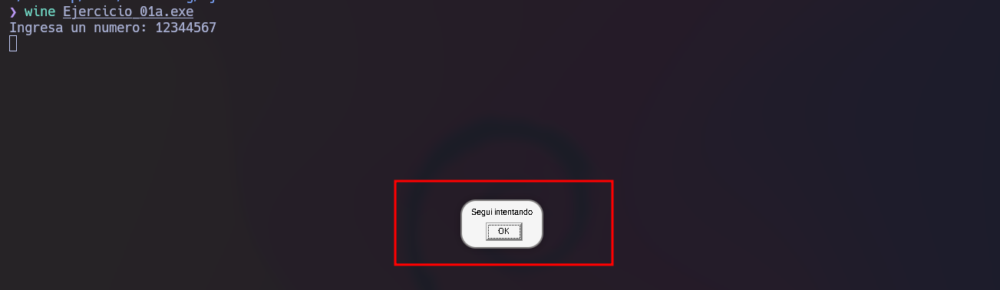
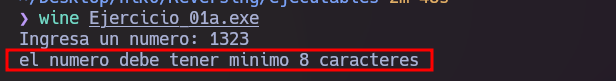
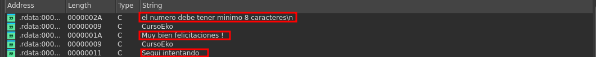
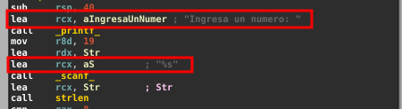
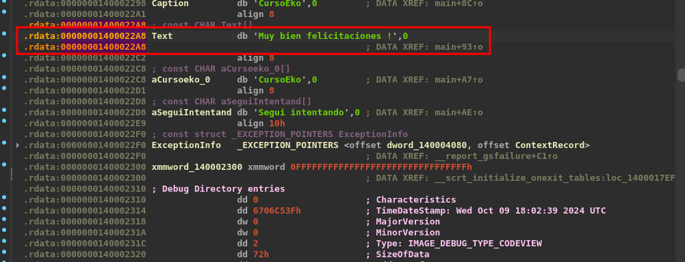
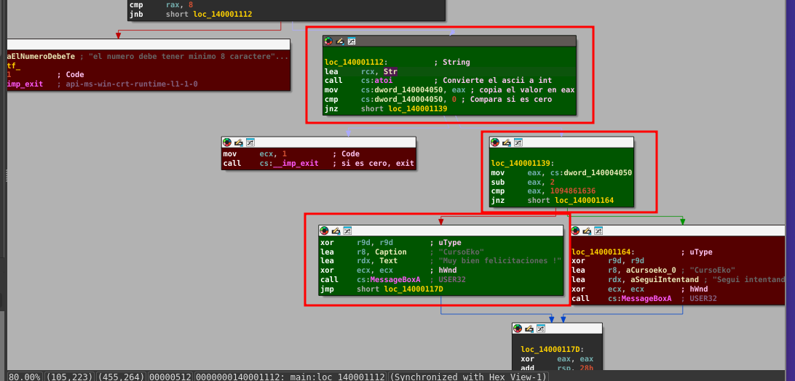
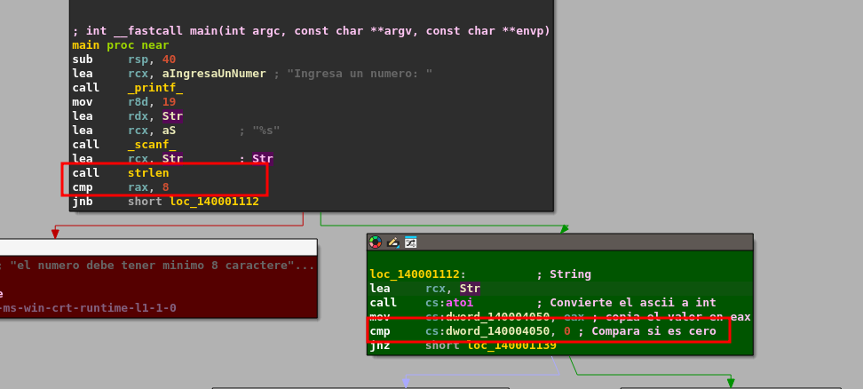
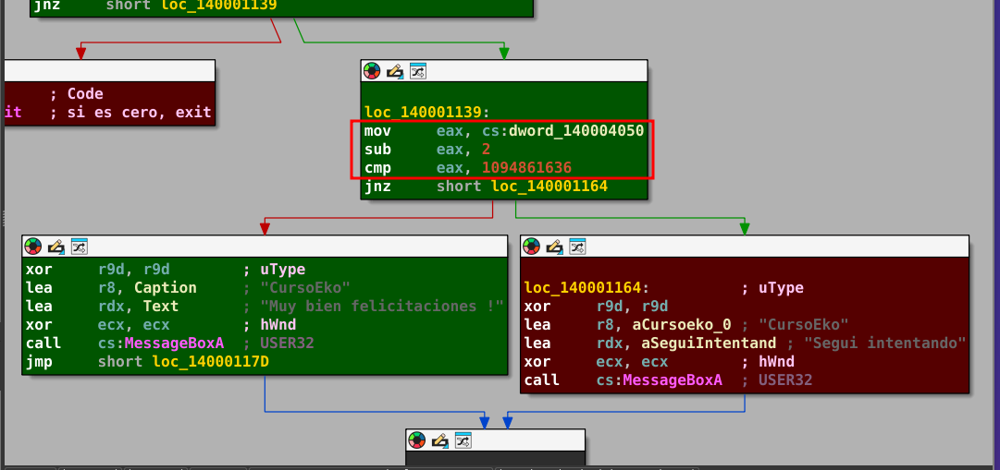
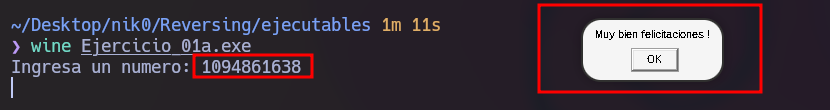

# Ejercicio 01a - Crackme básico

> **TL;DR:** el programa pide un número, lo convierte con `atoi`, le resta 2 y lo compara contra la constante `0x41424344`. El número correcto es **`1094861638`**.

## Información

| | |
|---|---|
| Fecha | 13/10/2026 |
| Binario | `Ejercicio_01a.exe` (12 KB) |
| Tipo | PE32+, consola, x86-64 |
| Compilado | 09/10/2024, MSVC, Release |
| SHA-256 | `2e9bd7efd6ff7ee1c7e786cad37bfa1c3d51fc44e5c4f2b2f3d6a82325bdd751` |
| Herramientas | IDA Free |
| Nivel | Principiante |
| Objetivo | Encontrar el número que hace aparecer el mensaje de éxito |

> El binario pertenece al material de un curso de reversing y no se incluye en el repositorio. Se deja el SHA-256 para poder verificar que se trata del mismo archivo.

## Funcionalidad del programa

Al ejecutar el programa nos pide un número por consola. Según lo que se ingrese, puede tomar uno de estos tres caminos:

| Entrada | Resultado |
|---|---|
| Menos de 8 caracteres | Imprime `el numero debe tener minimo 8 caracteres` y termina |
| 8 o más caracteres, número incorrecto | MessageBox `Segui intentando` |
| El número correcto | MessageBox `Muy bien felicitaciones !` |



Al ingresar un número incorrecto de 8 dígitos se muestra un MessageBox con la leyenda "Segui intentando".

En caso de no cumplir la consigna de ingresar un número con al menos 8 caracteres, veremos lo siguiente:




## Reconocimiento

Antes de mirar código, dos cosas que ya orientan el análisis.

**Strings** (`Shift+F12` en IDA). Están los tres mensajes y el formato del `scanf`:

```
Ingresa un numero: 
%s
el numero debe tener minimo 8 caracteres
CursoEko
Muy bien felicitaciones !
Segui intentando
```

El `%s` ya nos dice que la entrada se lee como **texto** y no como número, por lo que en algún lado tenemos que encontrar una conversión.

**Imports.** Los que importan para este ejercicio:

| Función | DLL | Para qué la usa |
|---|---|---|
| `strlen` | api-ms-win-crt-string | Validar el largo de la entrada |
| `atoi` | api-ms-win-crt-convert | Convertir el texto a entero |
| `exit` | api-ms-win-crt-runtime | Cortar si la entrada no es válida |
| `MessageBoxA` | USER32 | Mostrar el resultado |





## Análisis

### 1. Llegar a la función que valida

Al efectuar un doble click sobre `Muy bien felicitaciones !` en la ventana de strings y después `X` (xrefs) sobre la string. Hay una única referencia, dentro de `main` (`0x1400010C0`).



### 2. Vista general de main

La función es corta y tiene tres decisiones seguidas. Las dos primeras son filtros de entrada, la tercera es la que importa.



### 3. Lectura y validación de la entrada

```asm
1400010C4  lea   rcx, aIngresaUnNumer   ; "Ingresa un numero: "
1400010CB  call  printf
1400010D0  mov   r8d, 13h               ; tamaño del buffer: 19 bytes
1400010D6  lea   rdx, buffer            ; 0x140004058
1400010DD  lea   rcx, aS                ; "%s"
1400010E4  call  scanf_s
1400010E9  lea   rcx, buffer
1400010F0  call  strlen
1400010F5  cmp   rax, 8
1400010F9  jnb   short loc_140001112    ; largo >= 8 -> sigue
1400010FB  lea   rcx, aElNumeroDebeTe   ; "el numero debe tener minimo 8 caracteres\n"
140001102  call  printf
140001107  mov   ecx, 1
14000110C  call  exit
```

- `scanf_s("%s", buffer, 0x13)`: lee hasta 18 caracteres a un buffer global.
- `strlen(buffer) >= 8`: si es más corto, avisa y sale con `exit(1)`.

Después convierte el texto a entero:

```asm
140001112  lea   rcx, buffer
140001119  call  atoi
14000111F  mov   cs:numero, eax         ; 0x140004050
140001125  cmp   cs:numero, 0
14000112C  jnz   short loc_140001139    ; numero != 0 -> sigue
14000112E  mov   ecx, 1
140001133  call  exit
```

La funcion "*atoi*" nos devuelve 0 cuando el texto no empieza con dígitos, así que este chequeo descarta entradas como `abcdefgh`: el programa termina sin mostrar nada.



### 4. La comparación

```asm
140001139  mov   eax, cs:numero
14000113F  sub   eax, 2
140001142  cmp   eax, 41424344h
140001147  jnz   short loc_140001164    ; distinto -> "Segui intentando"
140001149  xor   r9d, r9d               ; uType   = MB_OK
14000114C  lea   r8, aCursoeko          ; caption = "CursoEko"
140001153  lea   rdx, aMuyBienFelicit   ; text    = "Muy bien felicitaciones !"
14000115A  xor   ecx, ecx               ; hWnd    = NULL
14000115C  call  cs:MessageBoxA
```

Esta es toda la lógica del crackme: al número ingresado le resta 2 y lo compara contra la constante **0x41424344**. Si son iguales no se toma el **jnz** (*jump not zero*) y se muestra el mensaje de *éxito*.

Detalle: `0x41424344` son los bytes ASCII de `ABCD`. Si en IDA se aprieta `R` sobre la constante aparece como `'ABCD'`, lo cual puede hacer pensar que se compara texto, pero se está comparando el entero que devolvió `atoi`.



### Pseudocódigo

Reconstrucción de `main` a partir del desensamblado:

```c
char buffer[19];
int  numero;

int main(void)
{
    printf("Ingresa un numero: ");
    scanf_s("%s", buffer, 0x13);

    if (strlen(buffer) < 8) {
        printf("el numero debe tener minimo 8 caracteres\n");
        exit(1);
    }

    numero = atoi(buffer);
    if (numero == 0)
        exit(1);

    if (numero - 2 == 0x41424344)
        MessageBoxA(NULL, "Muy bien felicitaciones !", "CursoEko", MB_OK);
    else
        MessageBoxA(NULL, "Segui intentando", "CursoEko", MB_OK);

    return 0;
}
```

## Solución

Tenemos que despejar la condicion de base:

```
numero - 2 = 0x41424344
numero     = 0x41424344 + 2
numero     = 0x41424346
numero     = 1094861638
```

Este numero tambien cumple con los *dos filtros previos*: tiene 10 caracteres (**mínimo 8**) y es **distinto de 0**. 



## Conclusiones

- Buscar las strings de **éxito/error** y seguir sus *xrefs* alcanzó para llegar directo a la comparación, sin leer el resto del binario.

- El formato `%s` del `scanf` avisaba que la entrada era texto; ubicar el `atoi` explicó dónde pasaba a ser un número.

- Una constante que "*parece texto*" (`ABCD`) no implica que se compare texto: hay que mirar de dónde viene el otro operando.

- La "*protección*" es una sola resta con una constante en claro; se resuelve con análisis estático, sin necesidad de debugger.

## Referencias

- [atoi - Microsoft Learn](https://learn.microsoft.com/en-us/cpp/c-runtime-library/reference/atoi-atoi-l-wtoi-wtoi-l)
- [MessageBoxA - Microsoft Learn](https://learn.microsoft.com/en-us/windows/win32/api/winuser/nf-winuser-messageboxa)
- [Convención de llamadas x64 - Microsoft Learn](https://learn.microsoft.com/en-us/cpp/build/x64-calling-convention)

---

[← Volver al índice](../README.md)
